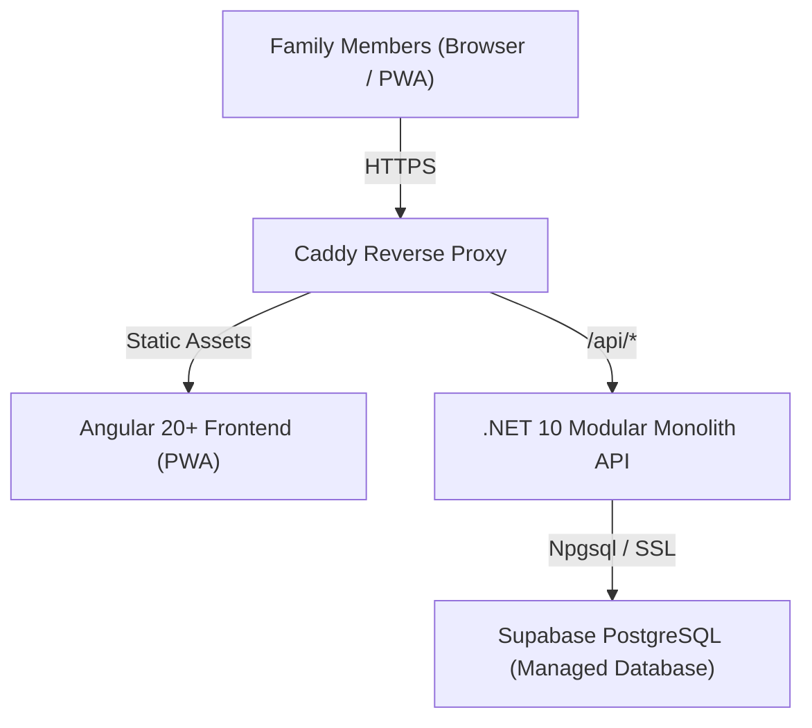
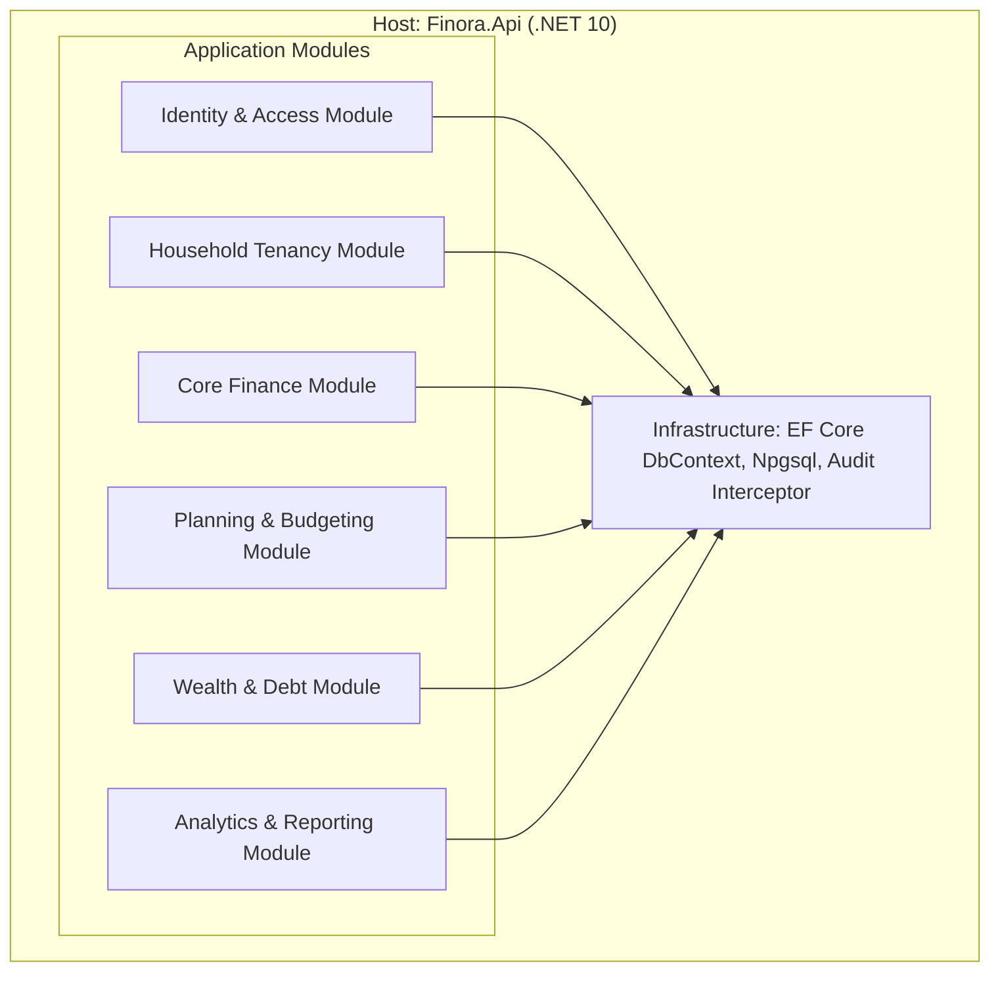
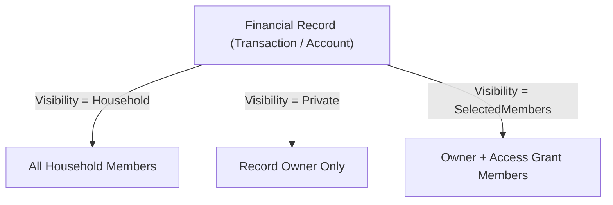
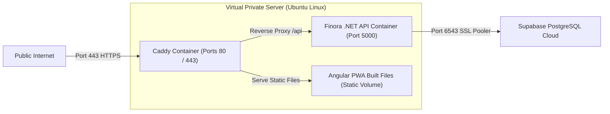

# Finora System Architecture

## 1. Executive Summary

Finora is a modern family wealth and personal finance management platform designed specifically for multi-member households. It balances collective family transparency (shared budgets, recurring bills, aggregate emergency funds) with individual privacy (private accounts, personal discretionary spending, selective visibility).

The system is architected as a **Modular Monolith**, maximizing engineering velocity, operational simplicity, and deployment cost-efficiency while maintaining strict internal domain boundaries.



---

## 2. Technology Stack & Architectural Decision Summary

| Layer | Technology | Key Capabilities |
| :--- | :--- | :--- |
| **Frontend** | Angular 20+ (Standalone) | Reactive Signals, RxJS, PWA, Lazy-Loaded Routes |
| **UI Framework** | NG-ZORRO + Tailwind CSS 4 | Enterprise UI components, responsive layout utilities |
| **Backend API** | .NET 10 (C# 13) Web API | High-throughput, strong typing, clean architecture |
| **ORM** | EF Core 10 (`Npgsql`) | LINQ queries, migrations, global query filters |
| **Database** | Supabase PostgreSQL 16+ | Managed relational persistence, atomic transactions |
| **Authentication** | ASP.NET Core Identity | Secure password hashing, multi-factor, token/cookie auth |
| **Reverse Proxy** | Caddy v2 | Automatic Let's Encrypt HTTPS, HTTP/3, reverse proxy |
| **Deployment** | Single VPS + Docker Compose | Low cost, low operational overhead, reproducible |

---

## 3. High-Level Modular Monolith Architecture

Rather than prematurely distributing into microservices with high network latency, distributed transaction overhead, and deployment complexity, Finora operates as a modular monolith within a single .NET process.



### Module Boundaries and Responsibilities

1. **Identity & Access**:
   - Manages user accounts, authentication tokens, password reset flows, and user profile metadata.
   - Enforces invite-only registration through cryptographically signed registration tokens.
2. **Household Tenancy**:
   - Manages household creation, member roles (`Owner`, `Admin`, `Member`), and membership invites.
   - Supplies verified tenant context to all downstream financial modules.
3. **Core Finance**:
   - Owns financial accounts (Bank, Credit Card, Cash, Wallet), transaction categories, transactions, splits, and transfers.
   - Guarantees atomic ledger mutations and enforces transfer semantics (transfers are balance adjustments, not expenses).
4. **Planning & Budgeting**:
   - Owns category-based monthly budgets, rollover configurations, recurring bills, and bill payment occurrences.
5. **Wealth & Debt**:
   - Manages loans, amortization schedules, principal-vs-interest payment splits, and savings goals.
   - Future extensions: mutual fund units, gold, and fixed deposits.
6. **Analytics & Reporting**:
   - Provides read-optimized aggregation queries for cash flow, net worth trends, category breakdown, and export generation.
   - Strictly enforces multi-member privacy boundaries: private transactions are excluded from non-permitted user aggregations.

---

## 4. Frontend Architecture (Angular 20+)

The frontend is an Angular Single Page Application (SPA) configured as a Progressive Web Application (PWA) with offline capabilities.

```text
frontend/src/app/
├── core/
│   ├── auth/              # Auth state, login/register flow, JWT interceptor
│   ├── guards/            # Auth guard, household selection guard, role guard
│   ├── interceptors/      # Error handler, correlation ID, idempotency header
│   └── services/          # Base HTTP client, theme service, notification service
│
├── shared/
│   ├── components/        # Confirm dialogs, currency display, privacy toggle
│   ├── directives/        # Role-based visibility directives
│   └── pipes/             # Currency formatter (paise to INR ₹), date/time formatters
│
└── features/
    ├── dashboard/         # Net worth, monthly summary, upcoming bills
    ├── accounts/          # Account list, account balance reconciliation, detail view
    ├── transactions/      # Transaction table, quick add, split editor, transfer modal
    ├── budgets/           # Monthly budget progress, category allocations
    ├── bills/             # Recurring bills calendar and occurrence tracker
    ├── debts/             # Loans, EMI calculator, debt payoff trajectory
    ├── goals/             # Savings goals, target dates, progress milestones
    └── settings/          # Household management, member permissions, categories
```

### Key Frontend Architectural Principles
- **Signals-First**: Component state is managed via Angular Signals (`signal`, `computed`, `effect`) for zero-overhead change detection.
- **Strict NG-ZORRO Utilization**: Standard components (`nz-table`, `nz-modal`, `nz-drawer`, `nz-form`, `nz-statistic`) are used instead of custom implementations.
- **Tailwind CSS 4**: Used for layout, grid systems, flexbox alignments, responsive breakpoints, and micro-spacing.
- **Privacy Shield**: The UI includes a client-side global privacy toggle that obscures sensitive account balances and monetary figures when viewing the app in public environments.

---

## 5. Backend Architecture (.NET 10 Clean Architecture)

The backend code is organized into clean architectural layers inside a single solution:

```text
backend/
├── src/
│   ├── Finora.Domain/             # Pure enterprise logic, no external packages
│   │   ├── Entities/              # User, Household, Account, Transaction, etc.
│   │   ├── Enums/                 # AccountType, TransactionType, VisibilityLevel, Role
│   │   ├── ValueObjects/          # Money (paise), DateRange
│   │   └── Exceptions/            # DomainException, TenancyViolationException
│   │
│   ├── Finora.Application/        # Use cases and application contracts
│   │   ├── Common/                # Result<T>, PagedResult<T>, ICurrentUserService
│   │   ├── Features/              # Sliced by feature (Accounts, Transactions, etc.)
│   │   │   ├── Commands/          # Command records and handler logic
│   │   │   ├── Queries/           # Query records and projection logic
│   │   │   └── Validators/        # FluentValidation rules
│   │   └── Interfaces/            # IFinoraDbContext, IAuditService
│   │
│   ├── Finora.Infrastructure/     # Persistence, external services, Identity
│   │   ├── Persistence/           # FinoraDbContext, EntityConfigurations
│   │   ├── Identity/              # ApplicationUser, TokenService, PasswordHasher
│   │   └── Migrations/            # EF Core generated migrations
│   │
│   └── Finora.Api/                # Web entry point
│       ├── Controllers/           # REST API endpoints grouped by feature
│       ├── Middleware/            # ExceptionHandling, TenancyMiddleware, RateLimiting
│       └── Program.cs             # DI container setup, pipeline configuration
│
└── tests/
    ├── Finora.Domain.Tests/       # Unit tests for domain math and invariants
    ├── Finora.Application.Tests/  # Validator and business logic tests
    └── Finora.Integration.Tests/  # WebApplicationFactory integration tests
```

---

## 6. Family Tenancy & Privacy Model

Multi-tenancy in Finora is scoped to the **Household**. A user can belong to one or more households, with one household selected as active per session context.

### Visibility Hierarchy
Every financial record (Account, Transaction, Budget, Loan, Goal) carries an explicit `visibility` level:

1. **`Household`** (Default):
   - Fully visible to all members of the household.
   - Included in household net worth, budget progress, and collective reports.
2. **`Private`**:
   - Strictly visible only to the record owner (`created_by_user_id`).
   - Excluded from household dashboard totals and shared analytics for other members.
3. **`SelectedMembers`**:
   - Visible to the owner and explicitly authorized members via `access_grants`.
   - Used for shared sub-finances (e.g., parents sharing specific savings or expenses hidden from children).



---

## 7. Database & Persistence Strategy

- **Supabase as Managed PostgreSQL**: Supabase is leveraged solely as an enterprise-grade managed PostgreSQL 16+ instance with connection pooling.
- **No Supabase Auth / JS SDK**: All client connections route through the .NET API. Angular never contacts Supabase directly, avoiding duplicate auth contexts, client-side key exposure, and synchronization bugs.
- **EF Core Tenancy Filtering**: Global Query Filters in EF Core automatically enforce `household_id = CurrentHouseholdId` across all tenant queries, preventing cross-tenant data leaks at the ORM layer.
- **PostgreSQL Native Integrity**: Composite foreign keys and database constraints ensure relational integrity cannot be violated even by manual or unvalidated queries.

---

## 8. Deployment Architecture

Finora is deployed to a single VPS (e.g., Hetzner / DigitalOcean) using Docker Compose and Caddy.



- **Zero-Downtime Static Asset Delivery**: Caddy serves compiled Angular assets directly from disk with immutable caching headers.
- **Auto SSL**: Caddy manages TLS certificate generation and renewal automatically via Let's Encrypt.
- **Resource Efficiency**: The entire backend API and Caddy stack operates comfortably within 1 GB to 2 GB of VPS RAM.

