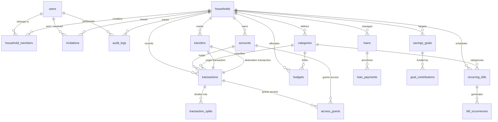

# Finora Database Schema

## 1. Schema Conventions & Design Standards

- **Primary Keys**: Every table uses a `UUID` primary key with default `gen_random_uuid()`.
- **Naming Convention**: Strict `snake_case` for tables, columns, indexes, foreign keys, and constraints.
- **Monetary Storage**:
  - Currency amounts are stored as **`BIGINT`** representing integer **paise** (1 INR = 100 paise; e.g., ₹1,500.75 is stored as `150075`).
  - Never use `FLOAT` or `DOUBLE` for financial amounts.
- **Investment Quantities**: Asset units, shares, and unit prices use `NUMERIC(18, 6)`.
- **Timestamps**: All creation and modification timestamps use `TIMESTAMPTZ` in UTC.
- **Financial Dates**: Explicit calendar dates use `DATE`.
- **Tenant Scoping**: All tenant data tables require `household_id UUID NOT NULL REFERENCES households(id) ON DELETE CASCADE`.
- **Composite Integrity**: Financial children (splits, occurrences, payments) include composite foreign keys `(household_id, parent_id)` to guarantee tenant isolation.

---

## 2. Entity-Relationship Diagram

---

## 3. Core Identity & Household Tenancy Tables

### `users`
Represents application users authenticated through ASP.NET Core Identity.

| Column | Type | Constraints | Description |
| :--- | :--- | :--- | :--- |
| `id` | `UUID` | `PRIMARY KEY` | Unique user identifier |
| `email` | `VARCHAR(256)` | `NOT NULL UNIQUE` | User email address (normalized) |
| `password_hash` | `TEXT` | `NOT NULL` | ASP.NET Core Identity password hash |
| `full_name` | `VARCHAR(128)` | `NOT NULL` | Display name of the user |
| `phone_number` | `VARCHAR(32)` | `NULL` | Optional phone number |
| `avatar_url` | `TEXT` | `NULL` | Profile avatar URI |
| `is_active` | `BOOLEAN` | `NOT NULL DEFAULT TRUE` | Active status flag |
| `created_at` | `TIMESTAMPTZ` | `NOT NULL DEFAULT clock_timestamp()` | Creation timestamp |
| `updated_at` | `TIMESTAMPTZ` | `NOT NULL DEFAULT clock_timestamp()` | Last update timestamp |

### `households`
The tenant boundary for shared financial records.

| Column | Type | Constraints | Description |
| :--- | :--- | :--- | :--- |
| `id` | `UUID` | `PRIMARY KEY` | Household identifier |
| `name` | `VARCHAR(100)` | `NOT NULL` | Household name (e.g. "Sharma Family") |
| `currency` | `VARCHAR(3)` | `NOT NULL DEFAULT 'INR'` | ISO 4217 currency code |
| `timezone` | `VARCHAR(64)` | `NOT NULL DEFAULT 'Asia/Kolkata'` | IANA timezone identifier |
| `created_by_user_id`| `UUID` | `NOT NULL REFERENCES users(id)` | Household creator/owner |
| `created_at` | `TIMESTAMPTZ` | `NOT NULL DEFAULT clock_timestamp()` | Creation timestamp |
| `updated_at` | `TIMESTAMPTZ` | `NOT NULL DEFAULT clock_timestamp()` | Last update timestamp |

### `household_members`
Links users to households with role-based access control.

| Column | Type | Constraints | Description |
| :--- | :--- | :--- | :--- |
| `id` | `UUID` | `PRIMARY KEY` | Record identifier |
| `household_id` | `UUID` | `NOT NULL REFERENCES households(id) ON DELETE CASCADE`| Tenant household |
| `user_id` | `UUID` | `NOT NULL REFERENCES users(id) ON DELETE CASCADE` | Member user |
| `role` | `VARCHAR(32)` | `NOT NULL DEFAULT 'Member'` | `Owner`, `Admin`, `Member`, `Viewer` |
| `joined_at` | `TIMESTAMPTZ` | `NOT NULL DEFAULT clock_timestamp()` | Timestamp joined |

*Indexes & Constraints*:
- `UNIQUE (household_id, user_id)`

### `invitations`
Secures the invitation-only registration workflow.

| Column | Type | Constraints | Description |
| :--- | :--- | :--- | :--- |
| `id` | `UUID` | `PRIMARY KEY` | Invitation identifier |
| `household_id` | `UUID` | `NOT NULL REFERENCES households(id) ON DELETE CASCADE`| Target household |
| `email` | `VARCHAR(256)` | `NOT NULL` | Invitee email |
| `role` | `VARCHAR(32)` | `NOT NULL DEFAULT 'Member'` | Assigned role upon acceptance |
| `token_hash` | `VARCHAR(128)` | `NOT NULL UNIQUE` | Cryptographic SHA-256 hash of invite token |
| `invited_by_user_id`| `UUID` | `NOT NULL REFERENCES users(id)` | User who generated invite |
| `status` | `VARCHAR(32)` | `NOT NULL DEFAULT 'Pending'` | `Pending`, `Accepted`, `Revoked`, `Expired` |
| `expires_at` | `TIMESTAMPTZ` | `NOT NULL` | Token expiration timestamp (e.g., 7 days) |
| `accepted_at` | `TIMESTAMPTZ` | `NULL` | When the invitation was accepted |
| `created_at` | `TIMESTAMPTZ` | `NOT NULL DEFAULT clock_timestamp()` | Creation timestamp |

---

## 4. Financial Accounts & Categories

### `accounts`
Stores financial accounts owned by household members.

| Column | Type | Constraints | Description |
| :--- | :--- | :--- | :--- |
| `id` | `UUID` | `PRIMARY KEY` | Account identifier |
| `household_id` | `UUID` | `NOT NULL REFERENCES households(id) ON DELETE CASCADE`| Tenant household |
| `owner_user_id` | `UUID` | `NOT NULL REFERENCES users(id)` | User owning the account |
| `name` | `VARCHAR(100)` | `NOT NULL` | Account display name (e.g., "HDFC Salary") |
| `type` | `VARCHAR(32)` | `NOT NULL` | `Savings`, `Checking`, `CreditCard`, `Cash`, `Loan`, `Investment` |
| `current_balance_paise`| `BIGINT` | `NOT NULL DEFAULT 0` | Current balance in paise |
| `currency` | `VARCHAR(3)` | `NOT NULL DEFAULT 'INR'` | Currency code |
| `account_number_mask` | `VARCHAR(8)` | `NULL` | Masked digits (e.g. "•••• 4012") |
| `visibility` | `VARCHAR(32)` | `NOT NULL DEFAULT 'Household'` | `Household`, `Private`, `SelectedMembers` |
| `is_archived` | `BOOLEAN` | `NOT NULL DEFAULT FALSE` | Soft-archive flag |
| `created_at` | `TIMESTAMPTZ` | `NOT NULL DEFAULT clock_timestamp()` | Creation timestamp |
| `updated_at` | `TIMESTAMPTZ` | `NOT NULL DEFAULT clock_timestamp()` | Last update timestamp |

*Indexes*:
- `INDEX ix_accounts_household_owner (household_id, owner_user_id)`

### `categories`
Hierarchical classification system for transactions and budgets.

| Column | Type | Constraints | Description |
| :--- | :--- | :--- | :--- |
| `id` | `UUID` | `PRIMARY KEY` | Category identifier |
| `household_id` | `UUID` | `NOT NULL REFERENCES households(id) ON DELETE CASCADE`| Tenant household |
| `parent_category_id`| `UUID` | `NULL REFERENCES categories(id) ON DELETE RESTRICT` | Parent category for nesting |
| `name` | `VARCHAR(64)` | `NOT NULL` | Category name (e.g. "Groceries", "Utilities") |
| `type` | `VARCHAR(32)` | `NOT NULL` | `Expense`, `Income`, `Transfer` |
| `icon` | `VARCHAR(64)` | `NULL` | NG-ZORRO / Ant Design icon identifier |
| `color_hex` | `VARCHAR(7)` | `NULL` | Hex color code (e.g. `#1890ff`) |
| `is_system` | `BOOLEAN` | `NOT NULL DEFAULT FALSE` | Flag for default system categories |
| `created_at` | `TIMESTAMPTZ` | `NOT NULL DEFAULT clock_timestamp()` | Creation timestamp |

---

## 5. Transactions, Splits & Transfers

### `transactions`
The immutable ledger of financial activity.

| Column | Type | Constraints | Description |
| :--- | :--- | :--- | :--- |
| `id` | `UUID` | `PRIMARY KEY` | Transaction identifier |
| `household_id` | `UUID` | `NOT NULL REFERENCES households(id) ON DELETE CASCADE`| Tenant household |
| `account_id` | `UUID` | `NOT NULL REFERENCES accounts(id) ON DELETE RESTRICT` | Target account |
| `category_id` | `UUID` | `NULL REFERENCES categories(id) ON DELETE SET NULL` | Assigned category |
| `created_by_user_id`| `UUID` | `NOT NULL REFERENCES users(id)` | Author of the transaction |
| `transaction_type` | `VARCHAR(32)` | `NOT NULL` | `Expense`, `Income`, `Transfer` |
| `amount_paise` | `BIGINT` | `NOT NULL CHECK (amount_paise > 0)` | Absolute amount in paise |
| `date` | `DATE` | `NOT NULL` | Financial transaction date |
| `payee` | `VARCHAR(128)` | `NULL` | Merchant / Payee name |
| `notes` | `TEXT` | `NULL` | Additional user notes |
| `visibility` | `VARCHAR(32)` | `NOT NULL DEFAULT 'Household'` | `Household`, `Private`, `SelectedMembers` |
| `is_split` | `BOOLEAN` | `NOT NULL DEFAULT FALSE` | Indicates child split rows exist |
| `created_at` | `TIMESTAMPTZ` | `NOT NULL DEFAULT clock_timestamp()` | Creation timestamp |
| `updated_at` | `TIMESTAMPTZ` | `NOT NULL DEFAULT clock_timestamp()` | Last update timestamp |

*Indexes*:
- `INDEX ix_transactions_household_date (household_id, date DESC)`
- `INDEX ix_transactions_account (account_id)`

### `transaction_splits`
Divides a single physical receipt into multiple expense categories.

| Column | Type | Constraints | Description |
| :--- | :--- | :--- | :--- |
| `id` | `UUID` | `PRIMARY KEY` | Split identifier |
| `household_id` | `UUID` | `NOT NULL REFERENCES households(id) ON DELETE CASCADE`| Tenant household |
| `transaction_id` | `UUID` | `NOT NULL REFERENCES transactions(id) ON DELETE CASCADE`| Parent transaction |
| `category_id` | `UUID` | `NOT NULL REFERENCES categories(id) ON DELETE RESTRICT`| Split category |
| `amount_paise` | `BIGINT` | `NOT NULL CHECK (amount_paise > 0)` | Split portion in paise |
| `notes` | `VARCHAR(256)` | `NULL` | Notes specific to split item |

### `transfers`
Pairs origin and destination transactions into an atomic transfer relationship.

| Column | Type | Constraints | Description |
| :--- | :--- | :--- | :--- |
| `id` | `UUID` | `PRIMARY KEY` | Transfer identifier |
| `household_id` | `UUID` | `NOT NULL REFERENCES households(id) ON DELETE CASCADE`| Tenant household |
| `source_transaction_id`| `UUID` | `NOT NULL UNIQUE REFERENCES transactions(id) ON DELETE CASCADE`| Origin debit transaction |
| `destination_transaction_id`| `UUID`| `NOT NULL UNIQUE REFERENCES transactions(id) ON DELETE CASCADE`| Destination credit transaction |
| `created_at` | `TIMESTAMPTZ` | `NOT NULL DEFAULT clock_timestamp()` | Creation timestamp |

---

## 6. Planning & Recurring Commitments

### `budgets`
Monthly category-level spending allocations.

| Column | Type | Constraints | Description |
| :--- | :--- | :--- | :--- |
| `id` | `UUID` | `PRIMARY KEY` | Budget identifier |
| `household_id` | `UUID` | `NOT NULL REFERENCES households(id) ON DELETE CASCADE`| Tenant household |
| `category_id` | `UUID` | `NOT NULL REFERENCES categories(id) ON DELETE CASCADE`| Budgeted category |
| `month` | `INTEGER` | `NOT NULL CHECK (month BETWEEN 1 AND 12)`| Calendar month (1-12) |
| `year` | `INTEGER` | `NOT NULL CHECK (year >= 2020)`| Calendar year (e.g. 2026) |
| `allocated_amount_paise`| `BIGINT` | `NOT NULL CHECK (allocated_amount_paise >= 0)`| Budget limit in paise |
| `rollover_enabled` | `BOOLEAN` | `NOT NULL DEFAULT FALSE` | Rollover unspent funds |
| `created_at` | `TIMESTAMPTZ` | `NOT NULL DEFAULT clock_timestamp()` | Creation timestamp |

*Constraints*:
- `UNIQUE (household_id, category_id, year, month)`

### `recurring_bills`
Scheduled subscriptions, utility bills, and insurance premiums.

| Column | Type | Constraints | Description |
| :--- | :--- | :--- | :--- |
| `id` | `UUID` | `PRIMARY KEY` | Bill schedule identifier |
| `household_id` | `UUID` | `NOT NULL REFERENCES households(id) ON DELETE CASCADE`| Tenant household |
| `category_id` | `UUID` | `NULL REFERENCES categories(id) ON DELETE SET NULL` | Default category |
| `name` | `VARCHAR(128)` | `NOT NULL` | Bill name (e.g. "Broadband", "Rent") |
| `expected_amount_paise`| `BIGINT`| `NOT NULL CHECK (expected_amount_paise > 0)` | Expected payment in paise |
| `frequency` | `VARCHAR(32)` | `NOT NULL` | `Weekly`, `Monthly`, `Quarterly`, `Yearly` |
| `next_due_date` | `DATE` | `NOT NULL` | Next expected payment date |
| `auto_record` | `BOOLEAN` | `NOT NULL DEFAULT FALSE` | Automatically record transaction |
| `is_active` | `BOOLEAN` | `NOT NULL DEFAULT TRUE` | Active schedule status |
| `created_at` | `TIMESTAMPTZ` | `NOT NULL DEFAULT clock_timestamp()` | Creation timestamp |

### `bill_occurrences`
Tracks individual periodic instances of recurring bills.

| Column | Type | Constraints | Description |
| :--- | :--- | :--- | :--- |
| `id` | `UUID` | `PRIMARY KEY` | Occurrence identifier |
| `household_id` | `UUID` | `NOT NULL REFERENCES households(id) ON DELETE CASCADE`| Tenant household |
| `bill_id` | `UUID` | `NOT NULL REFERENCES recurring_bills(id) ON DELETE CASCADE`| Parent bill schedule |
| `due_date` | `DATE` | `NOT NULL` | Specific due date |
| `status` | `VARCHAR(32)` | `NOT NULL DEFAULT 'Upcoming'` | `Upcoming`, `Paid`, `Overdue`, `Skipped` |
| `transaction_id` | `UUID` | `NULL REFERENCES transactions(id) ON DELETE SET NULL`| Recorded transaction link |
| `paid_at` | `TIMESTAMPTZ` | `NULL` | When payment occurred |

---

## 7. Wealth, Loans & Savings Goals

### `loans`
Tracks mortgages, car loans, personal loans, and credit lines.

| Column | Type | Constraints | Description |
| :--- | :--- | :--- | :--- |
| `id` | `UUID` | `PRIMARY KEY` | Loan identifier |
| `household_id` | `UUID` | `NOT NULL REFERENCES households(id) ON DELETE CASCADE`| Tenant household |
| `account_id` | `UUID` | `NOT NULL REFERENCES accounts(id) ON DELETE RESTRICT` | Associated liability account |
| `name` | `VARCHAR(128)` | `NOT NULL` | Loan title (e.g. "Home Loan SBI") |
| `original_principal_paise`| `BIGINT`| `NOT NULL CHECK (original_principal_paise > 0)`| Initial borrowed amount |
| `current_principal_paise` | `BIGINT`| `NOT NULL CHECK (current_principal_paise >= 0)` | Remaining balance |
| `annual_interest_rate` | `NUMERIC(5, 2)`| `NOT NULL CHECK (annual_interest_rate >= 0)` | Annual interest % (e.g. 8.50) |
| `tenure_months` | `INTEGER` | `NOT NULL CHECK (tenure_months > 0)` | Total loan tenure |
| `monthly_emi_paise` | `BIGINT` | `NOT NULL CHECK (monthly_emi_paise > 0)` | Calculated monthly installment |
| `start_date` | `DATE` | `NOT NULL` | Loan commencement date |
| `created_at` | `TIMESTAMPTZ` | `NOT NULL DEFAULT clock_timestamp()` | Creation timestamp |

### `loan_payments`
Explicitly records the breakdown of every loan payment.

| Column | Type | Constraints | Description |
| :--- | :--- | :--- | :--- |
| `id` | `UUID` | `PRIMARY KEY` | Payment record identifier |
| `household_id` | `UUID` | `NOT NULL REFERENCES households(id) ON DELETE CASCADE`| Tenant household |
| `loan_id` | `UUID` | `NOT NULL REFERENCES loans(id) ON DELETE CASCADE` | Parent loan |
| `transaction_id` | `UUID` | `NOT NULL REFERENCES transactions(id) ON DELETE RESTRICT`| Linked transaction |
| `principal_paise` | `BIGINT` | `NOT NULL CHECK (principal_paise >= 0)`| Principal reduction portion |
| `interest_paise` | `BIGINT` | `NOT NULL CHECK (interest_paise >= 0)` | Finance interest expense |
| `payment_date` | `DATE` | `NOT NULL` | Payment date |

### `savings_goals`
Targets for emergency funds, vacations, education, and capital purchases.

| Column | Type | Constraints | Description |
| :--- | :--- | :--- | :--- |
| `id` | `UUID` | `PRIMARY KEY` | Goal identifier |
| `household_id` | `UUID` | `NOT NULL REFERENCES households(id) ON DELETE CASCADE`| Tenant household |
| `name` | `VARCHAR(128)` | `NOT NULL` | Goal title (e.g. "6-Month Emergency Fund") |
| `target_amount_paise`| `BIGINT` | `NOT NULL CHECK (target_amount_paise > 0)` | Goal target in paise |
| `current_amount_paise`| `BIGINT`| `NOT NULL DEFAULT 0` | Current accumulated balance |
| `target_date` | `DATE` | `NULL` | Optional planned completion date |
| `is_completed` | `BOOLEAN` | `NOT NULL DEFAULT FALSE` | Goal completion status |
| `visibility` | `VARCHAR(32)` | `NOT NULL DEFAULT 'Household'` | `Household`, `Private`, `SelectedMembers` |
| `created_at` | `TIMESTAMPTZ` | `NOT NULL DEFAULT clock_timestamp()` | Creation timestamp |

### `goal_contributions`
Allocations of funds from accounts to specific savings goals.

| Column | Type | Constraints | Description |
| :--- | :--- | :--- | :--- |
| `id` | `UUID` | `PRIMARY KEY` | Contribution identifier |
| `household_id` | `UUID` | `NOT NULL REFERENCES households(id) ON DELETE CASCADE`| Tenant household |
| `goal_id` | `UUID` | `NOT NULL REFERENCES savings_goals(id) ON DELETE CASCADE`| Target goal |
| `transaction_id` | `UUID` | `NULL REFERENCES transactions(id) ON DELETE SET NULL`| Source transaction link |
| `amount_paise` | `BIGINT` | `NOT NULL CHECK (amount_paise > 0)` | Contributed amount in paise |
| `contribution_date` | `DATE` | `NOT NULL` | Contribution date |

---

## 8. Security, Permissions & Audit Logging

### `access_grants`
Facilitates selective privacy sharing for records marked `SelectedMembers`.

| Column | Type | Constraints | Description |
| :--- | :--- | :--- | :--- |
| `id` | `UUID` | `PRIMARY KEY` | Grant identifier |
| `household_id` | `UUID` | `NOT NULL REFERENCES households(id) ON DELETE CASCADE`| Tenant household |
| `resource_type` | `VARCHAR(32)` | `NOT NULL` | `Account`, `Transaction`, `Goal` |
| `resource_id` | `UUID` | `NOT NULL` | Target record UUID |
| `granted_to_user_id`| `UUID` | `NOT NULL REFERENCES users(id) ON DELETE CASCADE` | Permitted user |
| `granted_by_user_id`| `UUID` | `NOT NULL REFERENCES users(id)` | Authorizing user |
| `created_at` | `TIMESTAMPTZ` | `NOT NULL DEFAULT clock_timestamp()` | Grant timestamp |

*Constraints*:
- `UNIQUE (resource_type, resource_id, granted_to_user_id)`

### `audit_logs`
Append-only log of security and financial mutations.

| Column | Type | Constraints | Description |
| :--- | :--- | :--- | :--- |
| `id` | `UUID` | `PRIMARY KEY` | Audit log identifier |
| `household_id` | `UUID` | `NULL REFERENCES households(id) ON DELETE SET NULL` | Scoped household |
| `user_id` | `UUID` | `NULL REFERENCES users(id) ON DELETE SET NULL` | Performing user |
| `action` | `VARCHAR(64)` | `NOT NULL` | Action name (`Login`, `CreateTx`, `DeleteAccount`, etc.) |
| `entity_name` | `VARCHAR(64)` | `NOT NULL` | Affected table/entity |
| `entity_id` | `VARCHAR(64)` | `NOT NULL` | Primary key of affected entity |
| `old_values_json` | `JSONB` | `NULL` | Snapshot prior to mutation |
| `new_values_json` | `JSONB` | `NULL` | Snapshot after mutation |
| `ip_address` | `VARCHAR(45)` | `NULL` | Client IP address |
| `timestamp` | `TIMESTAMPTZ` | `NOT NULL DEFAULT clock_timestamp()` | Event timestamp |

---

## 9. Future Extensions: Investments & Physical Assets

Prepared relational structures for future phases:

### `investments` (Future Extension)
| Column | Type | Description |
| :--- | :--- | :--- |
| `id` | `UUID PRIMARY KEY` | Asset identifier |
| `household_id` | `UUID NOT NULL` | Scoped household |
| `account_id` | `UUID NOT NULL` | Associated investment portfolio account |
| `symbol_or_code` | `VARCHAR(32)` | ISIN, Ticker, or Scheme Code |
| `asset_type` | `VARCHAR(32)` | `MutualFund`, `Equity`, `Gold`, `FixedDeposit`, `PPF`, `NPS` |
| `quantity` | `NUMERIC(18, 6)`| Units/shares held |
| `average_buy_price_paise`| `BIGINT` | Cost basis per unit in paise |
| `current_nav_paise` | `BIGINT` | Latest NAV or market price in paise |
| `last_valuation_at`| `TIMESTAMPTZ` | Timestamp of latest NAV refresh |

