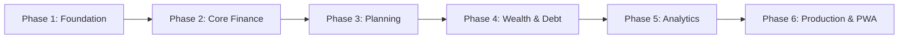

# Finora Implementation Plan

This roadmap defines the six sequential phases of Finora's engineering lifecycle. Following the **Ponytail Methodology** and agent operational instructions, **only one phase may be executed at a time**.

---

## Phase 1: Foundation & Tenancy Infrastructure

### Scope
- Initialize .NET 10 Web API solution with clean architectural boundaries (`Domain`, `Application`, `Infrastructure`, `Api`).
- Configure Supabase PostgreSQL connectivity via EF Core 10 and Npgsql.
- Implement ASP.NET Core Identity with password hashing, secure tokens/cookies, and refresh token rotation.
- Implement invitation-only registration mechanism (invitation tokens, initial setup seed token).
- Implement Household domain model, member roles (`Owner`, `Admin`, `Member`), and tenancy middleware with EF Core global query filters.
- Implement append-only Audit Logging interceptor for entity state changes.
- Initialize Angular 20+ frontend workspace with NG-ZORRO and Tailwind CSS 4.
- Build foundational UI layout: responsive sidebar, top navigation, user profile menu, household switcher, and dark/light theme foundation.

### Measurable Acceptance Criteria
1. [ ] .NET 10 solution compiles cleanly with zero warnings under nullable reference types and treat-warnings-as-errors.
2. [ ] EF Core migration successfully generates core identity and household tables on PostgreSQL with exact snake_case conventions.
3. [ ] First admin user registers successfully using a verified one-time seed token (`INITIAL_SETUP_TOKEN`).
4. [ ] Admin creates a household and invites a secondary user via email token; secondary user accepts and joins with role `Member`.
5. [ ] Cross-household data leak test confirms a member of Household A cannot query or mutate records belonging to Household B (returns 404 or 403).
6. [ ] Angular application bootstraps, displays login screen, authenticates, and renders household dashboard shell with NG-ZORRO navigation.

---

## Phase 2: Core Finance & Ledger Mechanics

### Scope
- Implement Accounts module: Bank, Credit Card, Cash, Wallet, and Liability accounts with `BIGINT` balances in paise.
- Implement Categories module: Hierarchical system categories (Groceries, Utilities, Housing, Transportation) with custom category authoring and icon selection.
- Implement Transactions ledger: Income, Expense, and Transfer transactions.
- Implement Transaction Splits: Dividing a single transaction into multiple category allocations.
- Implement Account Transfers: Atomic dual-entry debit and credit creation with strict transfer invariant enforcement (transfers do not alter income/expense totals).
- Implement Record Visibility levels (`Household`, `Private`, `SelectedMembers`) and access grant authorization.
- Angular UI: Account balance cards, transaction data table with server-side pagination, quick-add transaction modal, and split allocation editor.

### Measurable Acceptance Criteria
1. [ ] User creates an account with an opening balance (e.g., ₹50,000.00 = `5000000` paise).
2. [ ] Creating an expense transaction atomically decreases the account balance in paise.
3. [ ] Creating a transfer of ₹10,000 from Bank to Credit Card atomically updates both balances; ledger verifies total household expense delta is exactly ₹0.
4. [ ] Transaction split validation rejects submissions where the sum of split amounts does not equal the parent transaction total.
5. [ ] A transaction marked `Private` by Member A is invisible to Member B in transaction lists and does not leak in account balance overviews.
6. [ ] Currency display pipe correctly renders paise values into formatted Indian numbering system (e.g., `125050` paise -> `₹1,250.50` and `10000000` paise -> `₹1,00,000.00`).

---

## Phase 3: Planning, Budgets & Recurring Commitments

### Scope
- Implement Monthly Budgets: Category-level spending limits with optional rollover support.
- Implement Budget calculation engine: Aggregating monthly actual expenses against allocated limits while respecting visibility filters.
- Implement Recurring Bills: Weekly, Monthly, Quarterly, and Yearly schedules with due-date tracking.
- Implement Bill Occurrences: Upcoming bill calendar, mark-as-paid workflow linking to transactions, and overdue reminders.
- Angular UI: Visual budget progress bars (green/amber/red status), monthly spending forecast, and upcoming bills calendar view.

### Measurable Acceptance Criteria
1. [ ] Budget allocated for "Groceries" at ₹15,000 (`1500000` paise) updates progress percentage accurately when transactions are posted.
2. [ ] Private transactions belonging to Member A are excluded from Member B's shared budget calculations.
3. [ ] Recurring bill generates occurrences dynamically for the upcoming 60-day window.
4. [ ] Marking a bill occurrence as "Paid" automatically creates an expense transaction linked to the chosen account and updates bill status.
5. [ ] Overdue bills are highlighted with distinct visual indicators and badge counters.

---

## Phase 4: Wealth Management, Debt & Savings Goals

### Scope
- Implement Loans & Liabilities module: Principal tracking, interest rates, tenure, and monthly EMI calculation.
- Implement Loan Repayment Engine: Splits EMI payments into principal debt reduction and interest expenditure.
- Implement Savings Goals: Sinking funds and targets with target dates and target amounts in paise.
- Implement Goal Contributions: Transferring money from accounts into goal allocations without registering as household expenses.
- Angular UI: Loan amortization schedule viewer, payoff projection charts, savings goal progress cards with milestone celebrations.

### Measurable Acceptance Criteria
1. [ ] Loan amortization calculation matches standard banking formulas (reducing balance method) with zero floating-point drift.
2. [ ] Recording a loan repayment of ₹30,000 reduces loan principal by exact principal amount and records only the interest portion as finance expense.
3. [ ] Contributing ₹5,000 to "Emergency Fund" increments goal balance and decrements bank account without altering monthly budget expense totals.
4. [ ] Payoff trajectory visualizer accurately reflects impact of extra lump-sum principal prepayments.

---

## Phase 5: Analytics, Privacy-Safe Dashboards & Insights

### Scope
- Implement high-performance read-model projections for monthly cash flow (Income vs. Expense).
- Implement Net Worth calculation engine: (Sum of Assets) - (Sum of Liabilities), computed strictly on the server with user privacy isolation.
- Implement Spending Breakdown: Category distribution, merchant trends, and month-over-month variance.
- Implement Multi-Member Privacy Filtering: Household totals aggregate only shared data plus the requesting member's private data. Other members' private data remains completely excluded.
- Implement Data Export: Export transactions and accounts to CSV and JSON formats.
- Angular UI: Interactive dashboard charts, Net Worth trend lines, category donut charts, and global UI privacy toggle (one-click hide numbers).

### Measurable Acceptance Criteria
1. [ ] Dashboard displays accurate Net Worth, Monthly Income, Monthly Expense, and Net Savings Rate in under 200ms.
2. [ ] Multi-member audit verifies that Member A's Net Worth view includes Member A's private accounts, but Member B's view excludes Member A's private accounts.
3. [ ] Global UI privacy toggle instantly masks all currency values with `••••••` across all visible views.
4. [ ] CSV export produces well-formatted data matching applied search/date/category filters without exposing unauthorized private records.

---

## 6: Production Readiness, PWA & Hardening

### Scope
- Progressive Web App (PWA) configuration: Web App Manifest, offline caching service workers, app icons for desktop and mobile home screens.
- Docker containerization: Multi-stage Dockerfiles for .NET API and Angular static build.
- Caddy configuration: HTTPS reverse proxy, HTTP/3, Brotli/Gzip compression, security headers (CSP, HSTS, X-Frame-Options).
- VPS Deployment scripts: Automated container startup, database migration execution on deployment, and zero-downtime container swaps.
- Automated Backup Solution: Encrypted daily PostgreSQL dumps with automated retention pruning and tested restore script.
- CI/CD Workflows: GitHub Actions for linting, testing, Docker image building, and automated deployment.

### Measurable Acceptance Criteria
1. [ ] Lighthouse PWA audit scores 100 on Performance, Accessibility, Best Practices, and PWA criteria.
2. [ ] Angular application installs as a standalone PWA on mobile and desktop devices.
3. [ ] Caddy reverse proxy terminates TLS with an A+ rating on Qualys SSL Labs and correctly handles CORS, rate limiting, and static caching.
4. [ ] Automated test runner in CI passes 100% of unit and integration test suites before container builds.
5. [ ] Backup script generates AES-256 encrypted database dumps and restore script successfully rebuilds state on a clean database container.

