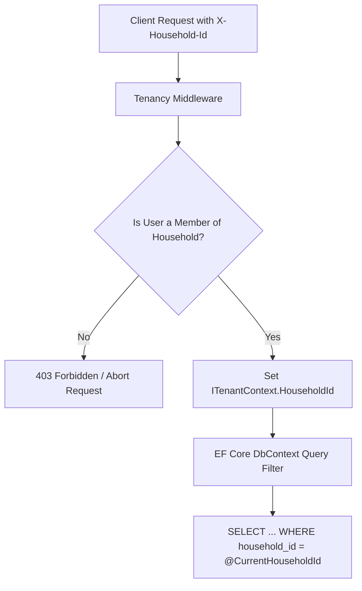

# Finora Security Architecture & Hardening Guide

Security in Finora is foundational. As a multi-member family financial application, the system protects against external compromise and guarantees internal family privacy boundaries.

---

## 1. Authentication Architecture

- **Engine**: ASP.NET Core Identity.
- **Password Storage**: Argon2id or PBKDF2 with HMAC-SHA512 and unique per-user cryptographically random salts. Minimum password policy: 12 characters, alphanumeric + symbols.
- **Session Tokens**:
  - Web SPA: **HTTP-Only, Secure, SameSite=Strict** cookies to prevent XSS-based token theft.
  - Native / PWA Sync: Short-lived JWT Bearer tokens (15–60 minutes) coupled with rotatable refresh tokens stored hashed in the database.
- **Invitation-Only Registration**:
  - The public registration endpoint is permanently disabled.
  - Initial administrator registration requires a pre-shared environment secret (`INITIAL_SETUP_TOKEN`).
  - New users can only register through single-use, time-bounded (7 days) invitation links cryptographically hashed with SHA-256.

---

## 2. Multi-Tenant Household Isolation

Every query and mutation touching financial data is isolated by `household_id`.



### Defense in Depth for Tenancy
1. **Never Trust Client Household IDs**: Even if the client sends an `X-Household-Id` header, the backend always cross-checks against the authenticated user's `household_members` records in database/cache.
2. **Global Query Filters in EF Core**:
   Every tenant entity configuration implements:
   ```csharp
   builder.HasQueryFilter(e => e.HouseholdId == _tenantContext.CurrentHouseholdId);
   ```
   This prevents accidental cross-tenant data leaks in raw LINQ queries.
3. **Database Constraints**:
   Composite foreign keys (e.g., `FOREIGN KEY (household_id, account_id) REFERENCES accounts(household_id, id)`) prevent an entity from associating with a parent from a foreign household.

---

## 3. Record-Level Financial Privacy & Visibility

Finora provides three distinct visibility tiers:
- **`Household`**: Visible to all members of the household.
- **`Private`**: Visible strictly to the creating user (`created_by_user_id == currentUserId`).
- **`SelectedMembers`**: Visible to the owner and explicitly authorized members registered in `access_grants`.

### Privacy Invariant Enforcement
- **Query Level Filtering**:
  ```csharp
  query = query.Where(t => 
      t.Visibility == VisibilityLevel.Household ||
      t.CreatedByUserId == currentUserId ||
      _dbContext.AccessGrants.Any(ag => 
          ag.ResourceType == "Transaction" && 
          ag.ResourceId == t.Id && 
          ag.GrantedToUserId == currentUserId));
  ```
- **Aggregation Isolation**:
  When calculating shared household metrics (monthly expenses, category budgets, net worth), private records of *other* users are strictly omitted.
  *Zero leakage rule*: Other users cannot deduce the existence or size of private transactions through aggregate differences.

---

## 4. PostgreSQL Row-Level Security (RLS) Strategy

While EF Core Global Query Filters enforce tenancy at the application layer, Supabase PostgreSQL supports native Row-Level Security (RLS) for defense-in-depth:

```sql
-- Enable RLS on core financial tables
ALTER TABLE transactions ENABLE ROW LEVEL SECURITY;

-- Application database user operates with app-level isolation
-- Specific direct SQL access policies can be enforced:
CREATE POLICY household_isolation_policy ON transactions
    FOR ALL
    USING (household_id = NULLIF(current_setting('app.current_household_id', true), '')::uuid);
```

---

## 5. Secrets Management

- **Zero Client-Side Secrets**:
  - The Angular application contains zero Supabase credentials, service role keys, or connection strings.
  - Angular connects only to the Finora .NET API.
- **Server Environment Isolation**:
  - All database connection strings, JWT signing keys, and setup tokens are injected at runtime via environment variables (`.env` or Docker secrets).
  - No secret values are checked into Git. `.gitignore` strictly blocks all `.env` files.
- **Key Rotation**:
  - JWT signing keys can be rotated without downtime by supporting active and previous key validation.

---

## 6. Backup Encryption & Disaster Recovery

- **Encryption at Rest**:
  - Automated database backup scripts dump PostgreSQL state using `pg_dump`.
  - Dumps are immediately piped through OpenSSL AES-256-CBC encryption:
    ```bash
    pg_dump ... | gzip | openssl enc -aes-256-cbc -salt -pbkdf2 -pass env:BACKUP_ENCRYPTION_PASSPHRASE -out backup.sql.gz.enc
    ```
- **Restricted Access**:
  - Backup directories have Linux file permissions `0700` restricted to the dedicated backup service user.
- **Tested Recovery**:
  - Backups must be tested quarterly with automated containerized restoration tests.

---

## 7. Audit Logging

Finora maintains an immutable `audit_logs` table tracking:
- User authentication events (successful logins, failed attempts, logout).
- Financial entity mutations (create/update/delete on accounts, transactions, transfers, budgets).
- Security events (household member invitations, role changes, access grants).

Audit records include:
- `user_id`, `household_id`, `action`, `entity_name`, `entity_id`.
- Pre-mutation (`old_values_json`) and post-mutation (`new_values_json`) snapshots.
- Client IP address and timestamp.
- **Sanitization**: Passwords, tokens, and bank account numbers are scrubbed from JSON snapshots before write.

---

## 8. Threat Modeling & OWASP Top 10 Mitigations

| Threat | Risk Level | Finora Defense Mechanism |
| :--- | :--- | :--- |
| **Broken Object Level Auth (BOLA / IDOR)** | Critical | Verified tenancy middleware + record-level visibility queries on every endpoint. |
| **Cross-Site Scripting (XSS)** | High | Angular built-in HTML encoding, Strict Content Security Policy (CSP), HTTP-Only cookies. |
| **Cross-Site Request Forgery (CSRF)** | High | SameSite=Strict cookies + Anti-Forgery token validation on state-modifying requests. |
| **SQL Injection** | Critical | 100% parameterized SQL via EF Core and Npgsql; zero raw string SQL interpolation. |
| **Sensitive Data Exposure** | High | TLS 1.3 enforced via Caddy; sensitive fields masked; no floating point or credential logs. |
| **Rate Limiting & Brute Force** | Medium | ASP.NET Core RateLimiter middleware configured on auth endpoints (max 5 attempts/minute). |

